<picture><source media="(prefers-color-scheme: dark)" srcset="assets/hero-dark.svg"></picture>

<!-- GAME:START -->
<a href="https://github.com/vladglass0/vladglass0/issues/new?title=c4%7Cmove%7C1%7C95358&body=Just%20press%20'Submit%20new%20issue'.%20You%20don't%20need%20to%20do%20anything%20else."><picture><source media="(prefers-color-scheme: dark)" srcset="game/assets/col-1-95358-dark.svg"></picture></a><a href="https://github.com/vladglass0/vladglass0/issues/new?title=c4%7Cmove%7C2%7C95358&body=Just%20press%20'Submit%20new%20issue'.%20You%20don't%20need%20to%20do%20anything%20else."><picture><source media="(prefers-color-scheme: dark)" srcset="game/assets/col-2-95358-dark.svg"></picture></a><a href="https://github.com/vladglass0/vladglass0/issues/new?title=c4%7Cmove%7C3%7C95358&body=Just%20press%20'Submit%20new%20issue'.%20You%20don't%20need%20to%20do%20anything%20else."><picture><source media="(prefers-color-scheme: dark)" srcset="game/assets/col-3-95358-dark.svg"></picture></a><a href="https://github.com/vladglass0/vladglass0/issues/new?title=c4%7Cmove%7C4%7C95358&body=Just%20press%20'Submit%20new%20issue'.%20You%20don't%20need%20to%20do%20anything%20else."><picture><source media="(prefers-color-scheme: dark)" srcset="game/assets/col-4-95358-dark.svg"></picture></a><a href="https://github.com/vladglass0/vladglass0/issues/new?title=c4%7Cmove%7C5%7C95358&body=Just%20press%20'Submit%20new%20issue'.%20You%20don't%20need%20to%20do%20anything%20else."><picture><source media="(prefers-color-scheme: dark)" srcset="game/assets/col-5-95358-dark.svg"></picture></a><a href="https://github.com/vladglass0/vladglass0/issues/new?title=c4%7Cmove%7C6%7C95358&body=Just%20press%20'Submit%20new%20issue'.%20You%20don't%20need%20to%20do%20anything%20else."><picture><source media="(prefers-color-scheme: dark)" srcset="game/assets/col-6-95358-dark.svg"></picture></a><a href="https://github.com/vladglass0/vladglass0/issues/new?title=c4%7Cmove%7C7%7C95358&body=Just%20press%20'Submit%20new%20issue'.%20You%20don't%20need%20to%20do%20anything%20else."><picture><source media="(prefers-color-scheme: dark)" srcset="game/assets/col-7-95358-dark.svg"></picture></a><picture><source media="(prefers-color-scheme: dark)" srcset="game/assets/board-95358-dark.svg"></picture>
<!-- GAME:END -->

<picture><source media="(prefers-color-scheme: dark)" srcset="assets/social-l-dark.svg"></picture><a href="https://discord.com/users/1094511004416745573"><picture><source media="(prefers-color-scheme: dark)" srcset="assets/social-1-dark.svg"></picture></a><picture><source media="(prefers-color-scheme: dark)" srcset="assets/social-r-dark.svg"></picture>

<picture><source media="(prefers-color-scheme: dark)" srcset="assets/stack-dark.svg"></picture>

<a href="https://github.com/vladglass0/id-cooling_lcd"><picture><source media="(prefers-color-scheme: dark)" srcset="assets/project-id-cooling-lcd-dark.svg"></picture></a>&nbsp;<a href="https://github.com/vladglass0/ltscheck"><picture><source media="(prefers-color-scheme: dark)" srcset="assets/project-ltscheck-dark.svg"></picture></a>

<a href="https://github.com/vladglass0/fakebuild"><picture><source media="(prefers-color-scheme: dark)" srcset="assets/project-fakebuild-dark.svg"></picture></a>&nbsp;<a href="https://github.com/vladglass0/lts-auth"><picture><source media="(prefers-color-scheme: dark)" srcset="assets/project-lts-auth-dark.svg"></picture></a>

<picture><source media="(prefers-color-scheme: dark)" srcset="assets/stats-dark.svg"></picture>

<picture><source media="(prefers-color-scheme: dark)" srcset="assets/streak-dark.svg"></picture>

<picture><source media="(prefers-color-scheme: dark)" srcset="assets/wave-dark.svg"></picture>

<a href="https://example.com"><picture><source media="(prefers-color-scheme: dark)" srcset="assets/button-1-dark.svg"></picture></a>&nbsp;&nbsp;<a href="https://github.com/vladglass0?tab=repositories"><picture><source media="(prefers-color-scheme: dark)" srcset="assets/button-2-dark.svg"></picture></a>

<a href="https://metawka.github.io/expressive-profile/?from=vladglass0"><picture><source media="(prefers-color-scheme: dark)" srcset="assets/credit-dark.svg"></picture></a>

